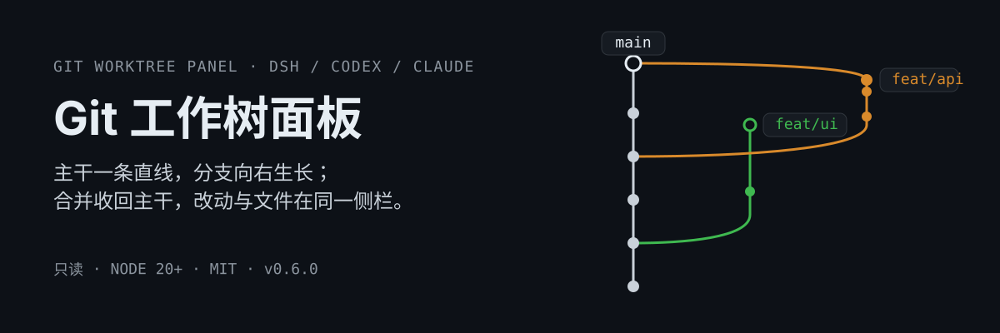
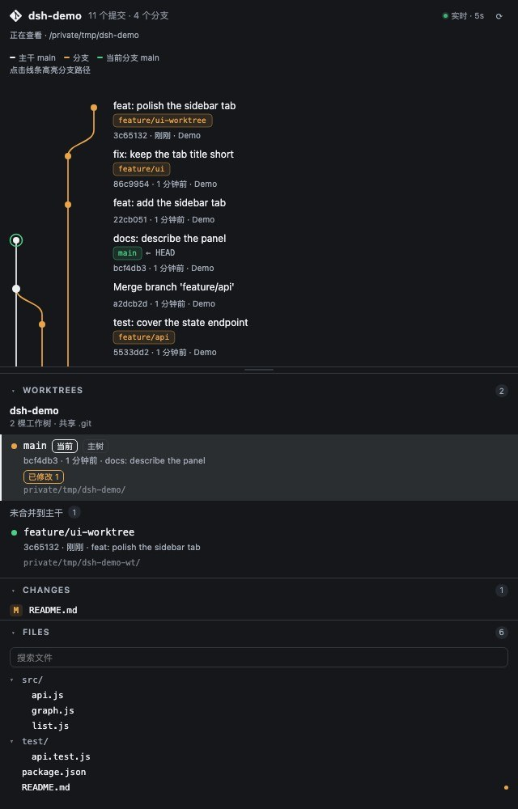
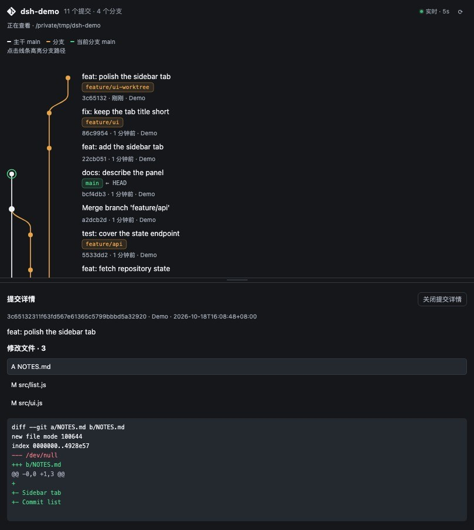
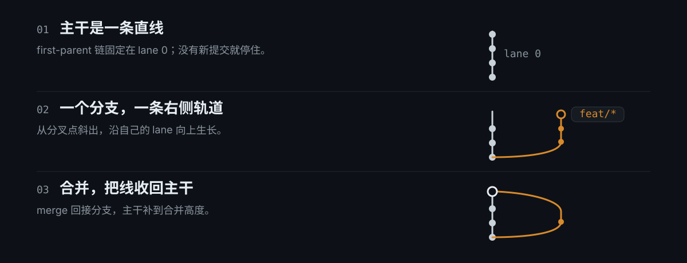

<p align="center">
  
</p>

<p align="center">
  <strong>在一个侧栏里读完 Git 的分支、工作树和改动。</strong><br/>
  只读查看，不 checkout、不切目录；DSH / Codex / Claude 共用同一套拓扑与数据层。
</p>

## 长什么样

<p align="center">
  
</p>

<p align="center"><sub>上半：分支 / 合并拓扑，主干竖直、分支向右；下半：WORKTREES、CHANGES、FILES。</sub></p>

点开任意提交，完整消息、修改文件和单文件差异就在同一栏展开：

<p align="center">
  
</p>

## 为什么不是普通的 git 图

多数 Git 图把提交均匀铺开，分支一动，主干就跟着拐。这里按阅读顺序排：

- **主干永远是一条直线。** first-parent 链固定在 lane 0，其他分支不会把它推来推去；没有新提交时，它就停在最后一个主干提交。
- **一个分支，一条右侧轨道。** 分支从分叉点斜着离开主干，之后沿自己的 lane 竖直生长；分支比主干新，就自然地高出主干。
- **合并把线收回主干。** merge 提交落在主干上，第二父回接分支，主干同时补到合并的高度。
- **已合并且落后于主干的引用只保留标签。** 不再为它长出空轨道；刚创建、还没有提交的分支也只有一个标签和一个空心端点。
- **点一条线，就高亮整条分支。** 其他路径变淡，流动方向是旧提交 → 新提交；`Enter` / 空格选择，`Esc` 取消。

<p align="center">
  
</p>

## 安装

### DSH

仓库根目录就是一个标准 DSH 插件包：`package.json` 声明 `dsh.bundle.patch`、`dsh.client` 与 `engines.dsh`。

**从「发现」安装（推荐）**：打开 **插件 → 实验性插件 → 更多 → 自定义插件市场**，添加索引源：

```text
https://leonz666.github.io/dsh-gitworktree-gui/market/index.json
```

然后在 **发现** 里搜索「Git 工作树面板」点安装。

**直接安装**（插件页或 `plugin_manager` 工具）：

```text
plugin_manager action=install_bundle target=dsh-gitworktree-gui
```

| target 形式 | 适用场景 |
| --- | --- |
| `dsh-gitworktree-gui` | npm 上的已发布版本 |
| `git+https://github.com/LeonZ666/dsh-gitworktree-gui.git` | 直接安装当前 `main`（不要用 `github:` 简写，匿名用户会走 SSH） |
| `/绝对路径/dsh-gitworktree-gui-<版本>.tgz` | 离线包，仓库根执行 `npm pack` 得到 |
| `/绝对路径/dsh-gitworktree-gui` | 本地源码，`link:` 安装，改代码即时生效 |

非桌面 profile 也可以用终端：

```sh
dsh plugin --profile <profile> add dsh-gitworktree-gui
```

`engines.dsh` 要求 `>=0.2.1-rc.2`，不满足时安装会被拒绝并回滚。装好后刷新 Web 页面；宿主入口 `index.js` 的改动需要重开 DSH。

### Codex

```sh
npm ci
npm run build:codex
codex plugin marketplace add .
codex plugin add git-worktree-panel@local-git-worktree
```

然后在目标项目的聊天里发一句：**打开当前项目的 Git 工作树面板**。这是聊天指令，没有同名菜单按钮。

### Claude Code / Claude 桌面端

需要函数钩子模块与 `$.ui` Pane API；普通 Claude 网页聊天不在适配范围。

```sh
claude plugin validate .
claude plugin test .
claude --plugin-dir "/绝对路径/dsh-gitworktree-gui"
```

或在支持该 API 的交互会话里：`/plugin marketplace add /绝对路径/dsh-gitworktree-gui`，再 `/plugin install git-worktree-gui@dsh-gitworktree-gui`。

## 用起来

1. **DSH**：点会话头部右上角的 Git 图标，面板作为右栏标签打开；**Codex**：发送上面的聊天指令；**Claude**：`/git-worktrees`。
2. 默认读取当前会话目录。在 WORKTREES 里点别的工作树，只切换「看哪棵树」，不执行 checkout，也不改变聊天的工作目录。
3. 点提交看详情，点线段选路径；「返回会话工作区」回到默认目录，关闭标签页即停止轮询。
4. 目录还没 `git init` 时，面板会给出提示；初始化后点「已初始化，重新读取」。插件不会替你初始化或修改仓库。

<details>
<summary><strong>更新与卸载</strong></summary>

**DSH**：用新 spec 再执行一次 `install_bundle`；同名包已安装时先卸载再装。停用与卸载：

```text
plugin_manager action=set_bundle target=dsh-gitworktree-gui enabled=false
plugin_manager action=remove_bundle target=dsh-gitworktree-gui
```

**Codex**：重新 `npm run build:codex` 后执行 `codex plugin add git-worktree-panel@local-git-worktree`；卸载用 `codex plugin remove git-worktree-panel@local-git-worktree`。

**Claude**：`/plugin uninstall git-worktree-gui@dsh-gitworktree-gui`；临时加载方式下次启动不传 `--plugin-dir` 即可。

</details>

## 三端能力

| 能力 | DSH | Codex | Claude |
| --- | --- | --- | --- |
| 拓扑、工作树、改动、文件树 | ✓ | ✓ | ✓ |
| 常驻入口 | 会话头部图标 | 聊天指令 | `/git-worktrees` + 状态栏摘要 |
| 点击线段高亮 / 流动动画 | ✓ | ✓ | — |
| 悬停分支卡、提交详情与 diff | ✓ | ✓ | — |
| 刷新 | 打开时 5s 轮询，隐藏页暂停 | 同左 | 打开时 5s，工具调用后再刷新 |

共享逻辑在 [`lib/core.js`](lib/core.js)：DSH 用 HTTP 适配器 [`index.js`](index.js)，Codex 用 [`codex/`](codex/)，Claude 用 [`hooks/register.tsx`](hooks/register.tsx)。Claude 侧的 Pane 是独立渲染，暂不包含路径动画、悬停卡和提交差异。

## 安全边界

- **只读。** 不提交、不切分支、不合并、不删除工作树、不初始化仓库。
- **不拼 shell。** DSH / Codex 用固定参数的 `execFile`，Claude 用 `$.process.run` 参数数组，Git 命令带超时。
- **只在本机。** DSH / Codex 的 HTTP 接口要求 loopback 连接与 loopback `Host`；DSH 只放行 `allowedRoots` 内的显式路径，会话 cwd 由宿主解析；Codex 额外校验同源，只提供固定静态资源。
- **有上限。** 采集 120 个提交、700 个文件；提交详情最多 300 个文件，单文件 diff 最多 128 KiB / 1200 行，超出会明示截断。
- **读失败不等于干净。** Git 出错时保留同一目标的旧快照并标记过期，不会把读取失败显示成「没有改动」。

## 隐私与数据

- 插件不收集、不上传任何数据，也没有遥测；除本机 loopback 路由外不发网络请求。
- 不写入你的仓库：只读 Git 状态，不 checkout、不 commit、不建删工作树、不初始化仓库。
- 唯一持久化是浏览器 `localStorage` 里的「当前查看路径」（按会话隔离）；关闭标签或清除浏览器数据即消失。
- 默认配置为空：没有预置仓库、没有作者目录，面板默认读当前会话的工作目录。

<details>
<summary><strong>配置：默认仓库与可点击范围</strong></summary>

DSH 的 `cordis.patch.yml` 里可以为这一行补配置；两个键都可选。

```yaml
- insert:
    - id: dsh-gitworktree-gui
      name: dsh-gitworktree-gui
      config:
        repo: /绝对路径/项目
        allowedRoots:
          - /绝对路径/项目所在目录
```

`repo` 是会话路径解析不到时的兜底目录；`allowedRoots` 限制显式选择路径的范围，默认是用户主目录。会话自己的 cwd 由宿主解析，优先于兜底仓库，且不受「显式路径」围栏限制。

</details>

<details>
<summary><strong>图谱间距与布局规范</strong></summary>

几何尺寸统一定义在客户端的 `GRAPH_SPACING`，DSH 与 Codex 共用：

| 项目 | 尺寸 |
| --- | --- |
| 相邻轨道中心距 | 32px |
| 主干左侧留白 | 20px |
| 文字区域最小宽度 | 200px |
| 有标签 / 无标签提交行距 | 60px / 44px |
| 无独立提交的分支行距 | 48px |
| 单轨道转弯高度 | 32px，跨轨每多一轨 +8px |

轨道变多时扩展图谱宽度，不压缩字号；窄侧栏只让图区横向滚动。提交按 `--topo-order` 排列，布局在拓扑候选间做有界交换以减少交叉，但不保证复杂 DAG 完全没有交叉。

</details>

<details>
<summary><strong>常见问题</strong></summary>

| 现象 | 检查方法 |
| --- | --- |
| DSH 里看不到 Git 图标 | 确认 bundle 已选入、页面已刷新；改过宿主代码就重开 DSH |
| 打开面板提示「不是 Git 仓库」 | 目标目录没有 `.git`；`git init` 后点「已初始化，重新读取」 |
| 路径被拒绝（403） | DSH 检查 `allowedRoots`，Codex 只允许启动项目与启动时已有的工作树 |
| Codex 找不到入口 | 入口是聊天指令；用 `codex plugin list` 确认安装，必要时重新加载 skill |
| 更新后还是旧界面 | 区分源码与安装副本：Codex 重新构建并重启旧服务，DSH 重载宿主 |
| 启动报缺少 `dist/server.mjs` | 在仓库根执行 `npm ci && npm run build:codex` 后再安装 |

</details>

## 开发

```sh
npm ci
npm run verify   # 语法检查 + 生成物检查 + Node 回归 + 市场索引校验 + npm pack dry-run
```

市场索引由 CI 在发布时生成到 `_site/` 并部署到 Pages，**不提交到仓库**；本地可用 `npm run market:index` 预览。

每次版本迭代用一条分支与一个 PR：`npm run iterate:start -- <版本> [slug]`，细节见 [RELEASING.md](RELEASING.md)。迭代产物写在 `.artifacts/<版本>/`（已忽略），迭代上下文写在 `iterations/<版本>.md`（跟踪）。

当前 `npm test` 为 78 项，覆盖拓扑布局、路径选择、提交详情、轮询、并发与读取围栏。Codex 侧在合并前用内置浏览器验收过多分支、路径选择、悬停卡、提交详情和窄栏；DSH 侧已验证路由与注册；Claude 侧需要本机 `claude` 环境自行 `validate` / `test`。

包目录里是同一份源码的三个入口：DSH（根目录）、Codex（[`codex/`](codex/)）、Claude（[`.claude-plugin/`](.claude-plugin/) + [`hooks/`](hooks/)）。`npm pack` 只带运行所需文件，可直接作为上面的 tarball target 安装。

## License

[MIT](LICENSE)
