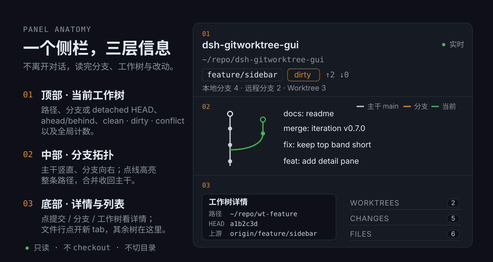

<p align="center">
  
</p>

<p align="center">
  <strong>在一个侧栏里读完 Git 的分支、工作树和改动。</strong><br/>
  只读查看：不 checkout、不切目录、不提交。
</p>

## 面板

<p align="center">
  
</p>

- **顶部 · 当前工作树**：路径、分支（detached 时显示 `detached @ <sha>`）、`↑ahead ↓behind`、`clean / dirty / conflict`，以及 `本地分支 · 远程分支 · Worktree` 计数。
- **中部 · 分支拓扑**：主干永远是一条直线，分支向右生长，合并收回主干；点一条线高亮整条路径。
- **底部 · 详情与列表**：点提交 / 分支 / 工作树看详情；其余工作树、CHANGES、FILES 都在这里，文件行可直接点开预览。

## 安装（DSH）

### 从插件市场（推荐）

打开 **插件 → 实验性插件 → 更多 → 自定义插件市场**，添加索引源：

```text
https://leonz666.github.io/dsh-gitworktree-gui/market/index.json
```

然后在 **发现** 里搜索「Git 工作树面板」点安装。

### 从 npm 安装

插件已发布到 npm：`dsh-gitworktree-gui`。终端里用 DSH CLI 装进指定 profile（需要本机有 `dsh` 与 `pnpm`，命令会把参数转发给 profile 目录里的 pnpm，从 npm 解析包）：

```sh
npm view dsh-gitworktree-gui version   # 查看最新版本，可选
dsh plugin --profile <profile> add dsh-gitworktree-gui
dsh plugin --profile <profile> add dsh-gitworktree-gui@<版本>   # 固定版本
```

桌面端 profile 由 Electron 管理，请用下面的插件页 / `plugin_manager`；CLI 的插件管理请求不作用于它。

### 在 DSH 里直接安装

在插件页或 `plugin_manager` 工具里：

```text
plugin_manager action=install_bundle target=dsh-gitworktree-gui
```

`target` 也可以是下面几种形式：

- `git+https://github.com/LeonZ666/dsh-gitworktree-gui.git` — 直接装当前 `main`（不要用 `github:` 简写，匿名用户会走 SSH）
- `/绝对路径/dsh-gitworktree-gui-<版本>.tgz` — 离线包，仓库根执行 `npm pack` 得到
- `/绝对路径/dsh-gitworktree-gui` — 本地源码，`link:` 安装，改代码即时生效

`engines.dsh` 要求 `>=0.2.1-rc.2`，不满足时安装会被拒绝并回滚。装好后刷新 Web 页面；改过宿主入口 `index.js` / `lib/` 需要重开 DSH。

<details>
<summary><strong>更新与卸载</strong></summary>

用新 spec 再执行一次 `install_bundle`；同名包已安装时先卸载再装。

```text
plugin_manager action=set_bundle target=dsh-gitworktree-gui enabled=false
plugin_manager action=remove_bundle target=dsh-gitworktree-gui
```

</details>

## 使用

1. 点会话头部右上角的 Git 图标，面板作为右栏标签打开。
2. 默认读取当前会话目录；顶部条始终显示正在查看的 worktree 的路径、分支与状态。
3. 在 WORKTREES 里点其他工作树，只切换「看哪棵树」，不执行 checkout，也不改变聊天的工作目录；「返回会话工作区」回到默认目录。
4. 点提交看完整消息、改动文件和 diff；点分支线段选路径；点工作树看 HEAD、上游和 dirty 文件数。
5. CHANGES / FILES 里的文件行点开，会在侧边栏新开一个 tab 显示文件内容；关闭 Git 面板标签页即停止轮询。
6. 目录还没 `git init` 时，面板会给出提示；初始化后点「已初始化，重新读取」。插件不会替你初始化或修改仓库。

<p align="center">
  
</p>

<p align="center"><sub>点开提交：完整消息、改动文件与单文件 diff 在同一栏展开。</sub></p>

## 只读与边界

只读：不提交、不切分支、不合并、不删除工作树、不初始化仓库。Git 用固定参数的 `execFile`，不拼 shell；DSH 路由只接受 loopback，显式路径受 `allowedRoots` 限制。采集上限为 120 个提交 / 700 个文件（提交详情 300 个文件，单文件 diff 128 KiB / 1200 行），读取失败会保留旧快照并标记过期，而不是显示成干净。

## License

[MIT](LICENSE) · 开发：`npm ci && npm run verify` · 发布见 [RELEASING.md](RELEASING.md)

在 Codex 和 Claude 上也能安装，适配入口见 [`codex/`](codex/) 与 [`hooks/`](hooks/)。
